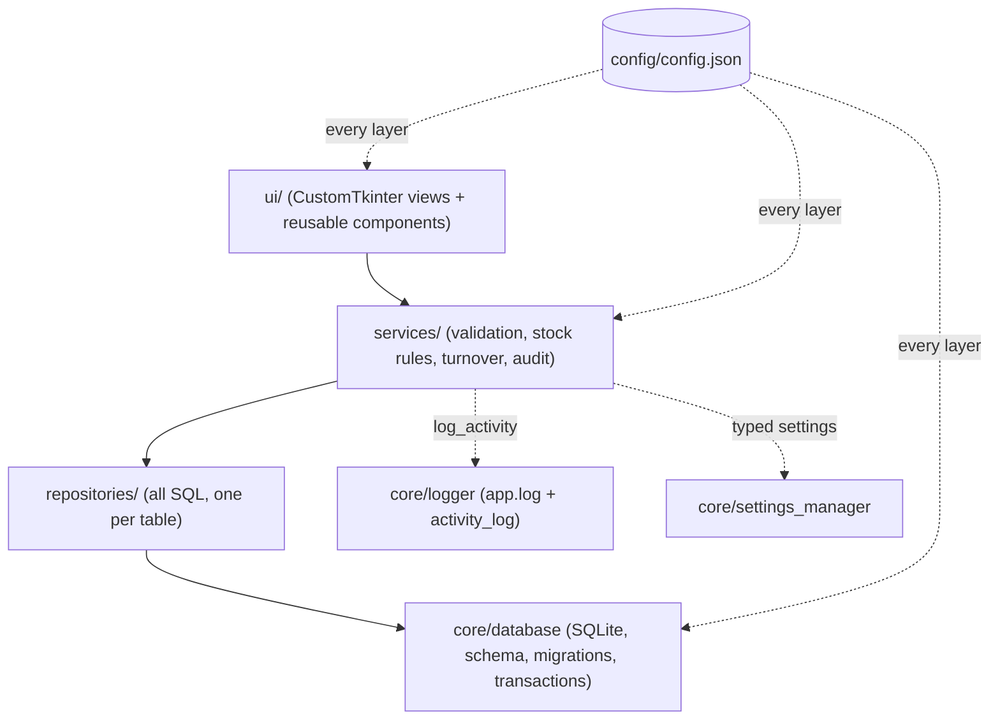

# Inventory Management System: TQM Quality Goal Q11 (Improve Maintainability)

**Course:** BBAT104 Fundamentals of TQM · B.Tech CSE (AI & ML), 5th semester, Amrapali University
**Student:** Siddhi Baluja · **Roll / Reg No:** 240302054

A desktop inventory system built with Python, CustomTkinter and SQLite. Its baseline TQM goal is to **eliminate stockouts and track the inventory turnover rate**, and it is engineered and measured against the assigned quality goal **Q11: Improve Maintainability**.

## Q11 features

| # | Feature | Where to see it |
|---|---|---|
| 1 | **Modular Structure** | Layered packages `ui → services → repositories → core`; the **About** screen lists every module live |
| 2 | **Config Files** | `config/config.json`, validated at start-up by `config/config_loader.py` (+ `schema.py`, `validation.py`) |
| 3 | **System Settings** | **Settings** screen → `settings` table; applied instantly, audited, reset to defaults |
| 4 | **Activity Logs** | **Activity Log** screen (`activity_log` table) + rotating `logs/app.log` |
| 5 | **Code Comments** | Header, class and function docstrings with type hints; `scripts/doc_coverage.py` reports 100% |

## Quality objectives and current results

Generated by `python scripts/quality_report.py --tests`; full details in [docs/quality_report.md](docs/quality_report.md).

| ID | Objective | Target | Result |
|----|-----------|--------|--------|
| QO1 | Separation of concerns | UI never runs SQL; layers only call downward | ✅ enforced by structure ([architecture](docs/architecture.md)) |
| QO2 | Zero hard-coded configuration | Paths, thresholds, theme, page size, currency, log level, colours, fonts in config | ✅ `config.json` + schema validation |
| QO3 | Behaviour changeable without code edits | Settings applied at runtime | ✅ Settings screen (live) |
| QO4 | Full traceability | 100% of CRUD, stock, settings, export and error actions logged with old→new | ✅ atomic with each change |
| QO5 | Documented code | 100% docstrings + type hints | ✅ **100%** (modules, classes, public functions, hints) |
| QO6 | Low complexity | Avg CC ≤ 5 (A), MI ≥ 65 every file | ✅ **avg CC 1.91 (A)**, **min MI 65.4** (avg 81.9) |
| QO7 | Regression safety | Repository + service tests pass | ✅ **154 tests passing** |

## Features

- **Products, categories, suppliers:** full CRUD with search, column sorting and pagination (page size from settings). Products with history are soft-deleted and restorable.
- **Stock:** stock in / stock out / adjustment (counted quantity plus reason). Stock never goes negative, and every movement is atomic with its audit entry. History is filterable by product, type and date range.
- **Stockout prevention:** low-stock rows in red (stockouts darker), a sidebar badge, the dashboard reorder list and low-stock toasts.
- **Turnover:** COGS ÷ daily-average inventory value per product and store-wide, plus days of stock remaining.
- **Dashboard:** five KPI cards, stock value by category, and units in vs out over 30 days (Matplotlib, follows light/dark mode).
- **Poka-Yoke validation:** required fields, numeric/positive checks, unique SKU, SKU/email/phone patterns and price-below-cost warnings. Errors appear as friendly messages, never tracebacks.
- **CSV export** of products, transactions, turnover, reorder list and activity log.

## Architecture



More detail, including the ER diagram, workflow and design decisions, is in [docs/architecture.md](docs/architecture.md).

## Folder structure

```
inventory management system/         (project root: BBAT104_TQM_240302054)
├── main.py                 entry point: config → database → services → logging → UI
├── requirements.txt        pinned dependencies
├── config/                 config.json, config_loader.py, schema.py, validation.py
├── core/                   database.py, schema.py, logger.py, settings_manager.py,
│                           setting_definitions.py, exceptions.py, constants.py
├── models/                 dataclasses: product, category, supplier, stock_transaction,
│                           activity_log, setting, movement, reports, filters, common
├── repositories/           base + one repository per table (SQL lives only here)
├── services/               category, supplier, product (+ product_validation), stock,
│                           report (+ turnover), settings, activity, system, container
├── ui/
│   ├── app.py, navigation.py, theme.py
│   ├── components/         data_table, pager, form_dialog, form_fields, confirm_dialog,
│   │                       status_bar, stat_card, chart_panel, toolbar, sidebar,
│   │                       product_picker, messages, table_types, window_utils
│   └── views/              dashboard, products, categories, suppliers, stock, reports,
│                           activity_log, settings, about (+ their panels / helpers)
├── utils/                  validators, parsing, formatters, date_helpers, csv_export
├── scripts/                seed_data.py, quality_report.py, doc_coverage.py
├── tests/                  154 pytest tests (config, core, models, repositories,
│                           services, utils, presenters)
├── data/                   inventory.db (generated, git-ignored)
├── logs/                   app.log (generated, git-ignored)
└── docs/                   SRS.md, architecture.md, user_manual.md,
                            quality_report.md (generated), tqm/ (review templates)
```

## Setup and run

Requires Python 3.10+ (developed on 3.13, Windows 11).

```bash
pip install -r requirements.txt
python scripts/seed_data.py      # sample data: 6 categories, 5 suppliers, 40 products, 90 days of history
python main.py
```

`python scripts/seed_data.py --reset` recreates the database from scratch.

## Tests and maintainability evidence

```bash
python -m pytest                             # 154 tests
python scripts/quality_report.py --tests     # radon CC + MI, doc coverage, pytest → docs/quality_report.md
python scripts/doc_coverage.py               # docstring / type-hint coverage only
```

## Screenshots

_Placeholders: add screenshots for the review presentation._

| Screen | Screenshot |
|---|---|
| Dashboard | `docs/screenshots/dashboard.png` |
| Products (low-stock highlighting) | `docs/screenshots/products.png` |
| Stock movement + history | `docs/screenshots/stock.png` |
| Reports: turnover | `docs/screenshots/reports.png` |
| Activity Log | `docs/screenshots/activity_log.png` |
| Settings | `docs/screenshots/settings.png` |
| About / Architecture | `docs/screenshots/about.png` |

## Documentation

- [Software Requirements Specification](docs/SRS.md)
- [Architecture, ER diagram and design decisions](docs/architecture.md)
- [User manual](docs/user_manual.md)
- [Quality report (generated)](docs/quality_report.md)
- [TQM templates](docs/tqm/README.md)

## Roadmap

**Review 3: measure and analyse**
- Export `ERROR` entries from the Activity Log and fill the [defect checksheet](docs/tqm/defect_checksheet.md) and [Pareto analysis](docs/tqm/pareto.md).
- Complete the [FMEA](docs/tqm/fmea.md), [SIPOC](docs/tqm/sipoc.md) and [CTQ tree](docs/tqm/ctq_tree.md) for the stock process.
- Add an in-app Pareto chart of defect categories (the data is already structured by `context` and `type`).

**Review 4: improve and control**
- Run [Fishbone](docs/tqm/fishbone.md) analysis on the top defect and apply the fix through [PDCA cycles](docs/tqm/pdca_log.md).
- Track before/after with `quality_report.py`, tests and Activity Log counts; add a CI workflow that fails on QO5/QO6/QO7 regressions.
- Possible enhancements: purchase-order suggestions from days-of-stock, per-user login, weighted-average costing.
