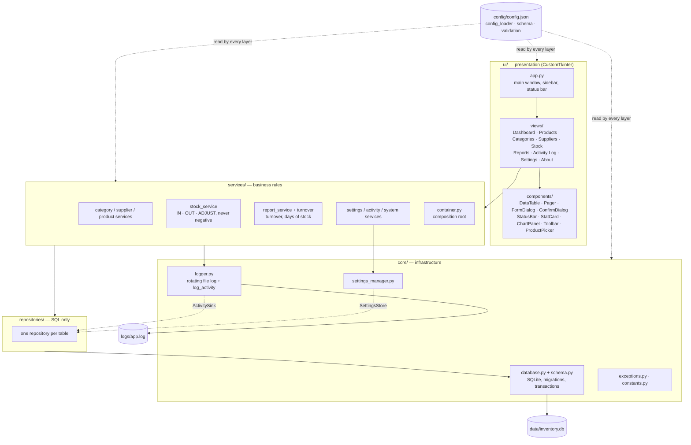
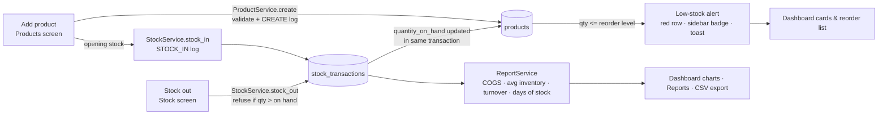
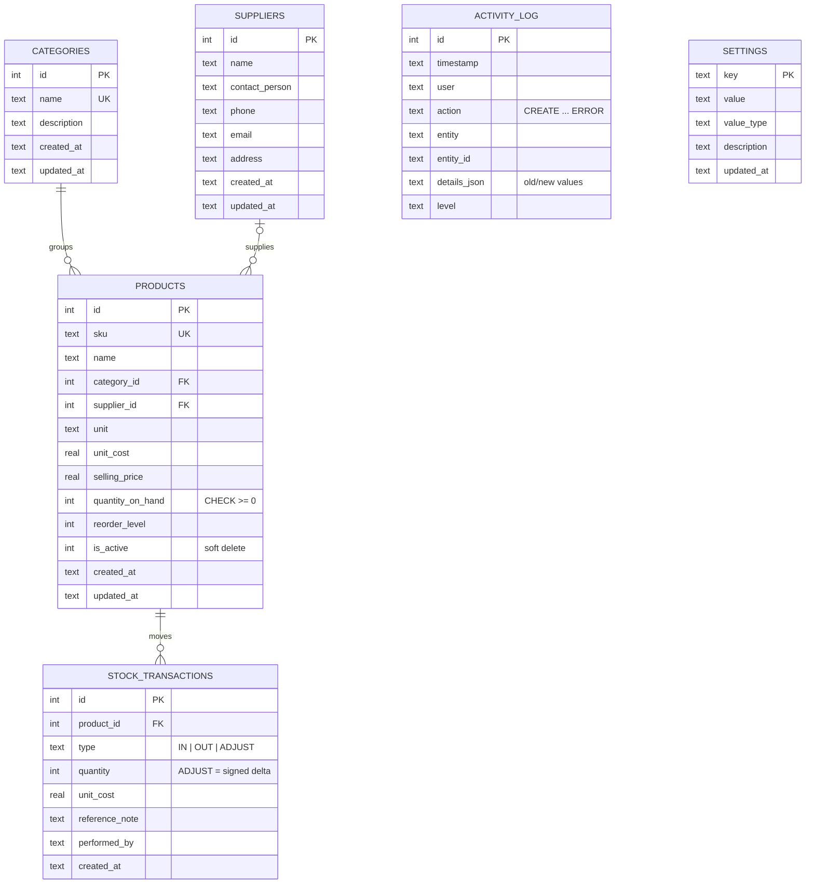

# Architecture — Inventory Management System (Q11: Improve Maintainability)

**Author:** Siddhi Baluja (240302054) · BBAT104 Fundamentals of TQM

## 1. Layers

### Layer rules (enforced by structure and review)

1. **`ui → services → repositories → core/database`.** Nothing imports upward.
2. **SQL lives only in `repositories/`** (plus the DDL in `core/schema.py`).
3. **Widgets live only in `ui/`.** Services never import tkinter.
4. `config`, `core/logger`, `core/constants`, `models` and `utils` are shared and may be used by any layer above `core`.
5. **No hard-coded configuration.** Paths, thresholds, theme, colours, fonts, page size, currency, date format and log level come from `config/config.json` or the `settings` table.
6. **Every create/update/delete, stock movement, settings change, export and caught error** is written through `core.logger.log_activity()`, called only from services.

## 2. Main workflow

## 3. Entity-relationship diagram

Indexes cover SKU, names, `category_id`, `supplier_id`, `product_id`, transaction type and every `created_at`/`timestamp` column. `PRAGMA foreign_keys = ON`; the schema version is stored in `PRAGMA user_version` and upgraded by `core/schema.MIGRATIONS`.

## 4. Package map

| Package | Responsibility | Key modules |
|---|---|---|
| `config/` | Load and validate `config.json` | `config_loader`, `schema`, `validation` |
| `core/` | DB connection and transactions, schema, logging, settings, exceptions | `database`, `schema`, `logger`, `settings_manager`, `setting_definitions` |
| `models/` | Dataclasses shared across layers | `product`, `stock_transaction`, `activity_log`, `common` (`ListQuery`, `Page`) |
| `repositories/` | All SQL; one class per table | `product_repository`, `stock_transaction_repository`, ... |
| `services/` | Validation, stock rules, analytics, audit | `stock_service`, `product_service`, `product_validation`, `turnover`, `report_service`, `container` |
| `ui/` | Window, screens, reusable widgets | `app`, `navigation`, `views/*`, `components/*` |
| `utils/` | Pure helpers | `validators`, `parsing`, `formatters`, `date_helpers`, `csv_export` |
| `scripts/` | Tooling | `seed_data`, `quality_report`, `doc_coverage` |

## 5. Design decisions

Recorded here as the brief requires whenever something was ambiguous.

| # | Decision | Reason |
|---|---|---|
| D1 | **Dependency inversion for core.** `core/logger.log_activity` writes through an `ActivitySink` protocol, and `SettingsManager` reads through a `SettingsStore` protocol. The repositories implement both, and `services/container.py` wires them. | The brief puts these helpers in `core/` but also says SQL lives only in repositories and nothing imports upward. Protocols satisfy both rules. |
| D2 | **Composition root in `services/container.py`.** The UI receives one `AppServices` object. | The UI never sees repositories or the database. |
| D3 | **Re-entrant transactions.** `Database.transaction()` nests, and only the outermost block commits. The audit entry is written *inside* the business transaction. | Data and audit trail commit or roll back together, which gives 100% traceability (QO4). |
| D4 | **Opening stock is a stock-in transaction**, and products are created with quantity 0. | Every unit on hand traces back to a movement. |
| D5 | **ADJUST stores a signed delta.** The operator enters the *counted* quantity, and a reason is mandatory. | Matches a physical stock count, and the history sums correctly. |
| D6 | **Soft delete** for products with history (`is_active = 0`, restorable). Hard delete applies only when a product has no movements. Categories and suppliers in use cannot be deleted. | Keeps history and foreign keys intact. |
| D7 | **Average inventory is the daily average of reconstructed closing stock**, not (opening + closing) / 2. | The two-point average overstated turnover about 3x when stock was replenished mid-period. Values use the current unit cost (a documented approximation). |
| D8 | **Errors.** Expected `AppError`s (validation, stock rules) are logged as `ERROR` at level `WARNING`. Unexpected exceptions are logged as `ERROR` at level `ERROR` with a short traceback. The UI shows friendly text only. | Both are defects for the Review 3–4 checksheet and Pareto chart; the level separates user mistakes from bugs. |
| D9 | **Single-login app.** The operator name and role are runtime settings and are recorded as the `user` on every audit entry. | The brief lists roles without authentication; the simplest option. |
| D10 | **QO6 is judged on application code**: `config core models repositories services ui utils main.py`. `scripts/` is tooling and is reported for information; QO5 covers both. | The brief asks for the measurement "over the source folders". |
| D11 | **Seeded data.** The seed script drives the real services with back-dated movements (`occurred_at`). Activity entries are timestamped at seeding time. | Seeded data is validated and audited exactly like real use. |
| D12 | **Modules kept small (MI ≥ 65).** Large screens are split into panels (`ListView`, `MovementPanel`, `TurnoverPanel`, ...). | The QO6 evidence, and smaller units are easier to change safely. |
| D13 | **Chart colours.** The two series use a colour-vision-deficiency-validated categorical pair (blue/orange, separate light and dark steps). Red, amber and green are reserved for status. | Accessible and unambiguous charts. |
| D14 | **`ttk.Treeview` for tables.** It is the only Tkinter widget used outside CustomTkinter. | CustomTkinter has no table widget (allowed by the brief). |
