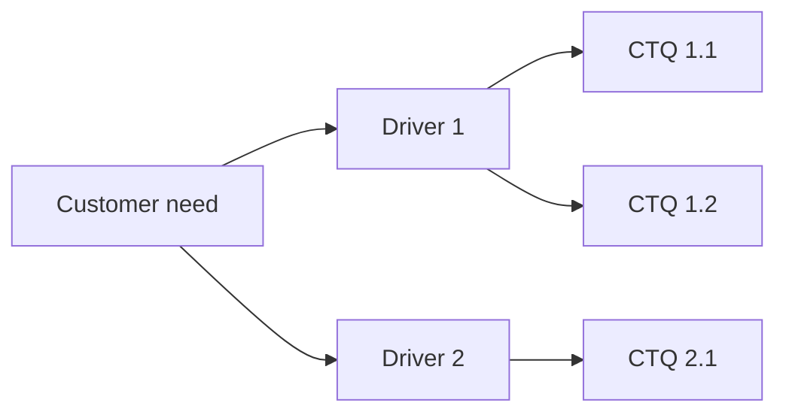

# CTQ tree

> Template for Reviews 3–4. Inventory Management System (Q11), Siddhi Baluja (240302054).

| Need | Driver | CTQ | Measure | Target / spec limit | Current value |
|---|---|---|---|---|---|
| | | | | | |
| | | | | | |
| | | | | | |
